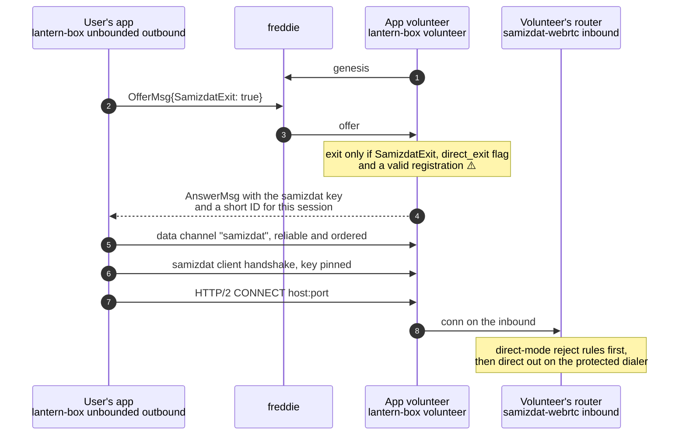

# Volunteer direct exit

## Goal

App volunteers exit Unbounded traffic themselves instead of relaying it to the Unbounded egress server. This covers Action Mode (pool) volunteers and personal-proxy helpers alike. Browser widgets can't dial arbitrary destinations, so they keep relaying to the egress server.

Every app on both sides already embeds lantern-box. So an app volunteer works like a Lamplighter node (`lantern-box serve --register`), not like the egress server:
- it gets a samizdat inbound and the reject rules from lantern-cloud's peer API;
- it serves that inbound to the censored user over a WebRTC data channel;
- its own router dials each destination.

The censored user's lantern-box runs a samizdat outbound over the same data channel. On this path there's no QUIC and no egress server.

Direct mode and reverse direct mode already exit from the helper, so they don't change. After this change, the only traffic that still reaches the egress server is traffic relayed by browser widgets, and traffic for users' apps too old to use a samizdat exit.

Why: the egress server costs money for every byte an app volunteer relays, and the extra hop makes the WebRTC path slower than it needs to be.

## Decisions

| Decision | Choice |
|---|---|
| Model | A Lamplighter node, not the egress server. The volunteer serves a samizdat inbound and its own router exits |
| Rules | The same reject rules (allowlist and abuse blocks) that direct mode gets from `/v1/peer/register`, enforced by the volunteer's router |
| Volunteer config | Every app volunteer registers through the peer API in a WebRTC-only mode: no listener, no dial-back, no pool route. It registers again hourly, as nodes do |
| Credentials | The volunteer's answer in signaling carries its samizdat public key and a short ID minted for that session. Freddie relays it over TLS, and the user pins the key for the session. Pool and personal-proxy sessions work the same way |
| Transport | A second WebRTC data channel, reliable and ordered, carries samizdat. The existing unreliable channel is untouched |
| Who chooses | The user's offer says it can use a samizdat exit. The volunteer decides per session |
| Web widgets | Unchanged. They relay over QUIC to the egress server |
| Rollout | Behind a lantern-cloud `direct_exit` flag for volunteers. Turning it off makes volunteers relay again |

## How it works today

**Unbounded:**
- The app volunteer is a sing-box service in lantern-box (`protocol/unbounded/volunteer.go`). It runs broflake's widget code. WebRTC slot *i* pipes packets to egress connection *i*, a WebSocket opened when a user connects.
- The data channel is unordered with no retransmits (`clientcore/consumer.go:161`). The user's app runs a QUIC server over it, and the egress server dials in as the QUIC client with a pinned client certificate.

**Lamplighter node** (`lantern-box node/`):
- It registers through `/v1/peer/register`.
- It runs the returned sing-box config: a samizdat inbound with lantern-cloud's credentials, plus the reject rules.
- lantern-cloud dials back to verify the inbound. The node then sends heartbeats and registers again every hour.

**Precedent:** `protocol/samizdatreverse/bridge.go` already runs samizdat over a connection that isn't a TCP listener (`DialSession`, then `http2.Server.ServeConn`), and hands each tunnelled connection to the router.

## Design

### unbounded `clientcore` (signaling and data channels)

- **Offer.** `OfferMsg` gets `SamizdatExit bool` (`json:",omitempty"`). New users' apps set it, and old volunteers ignore it.
- **Answer.** Today the answer is a bare `webrtc.SessionDescription`. It becomes an `AnswerMsg` that embeds `webrtc.SessionDescription` and adds `Exit *ExitParams` (`json:",omitempty"`). `ExitParams` has `PublicKey` (samizdat, base64) and `ShortID` (hex).
  
  Embedding keeps the description's `type` and `sdp` at the top level of the JSON. So an old user's app still decodes the answer as a `SessionDescription` and ignores `Exit`. A new user's app reads `Exit` only if it sent `SamizdatExit`.
- **Volunteer side.** `WebRTCOptions` gets `Exit *ExitOptions`, which is nil by default and always nil in a browser widget:
  - `Params func() (*ExitParams, bool)` returns the parameters for a new session, minting its short ID, or false when the volunteer can't exit now.
  - `Serve func(ctx context.Context, conn net.Conn, shortID string)` serves one session's samizdat channel.
  
  When the offer has `SamizdatExit` and `Params` returns true:
  - the volunteer puts the parameters in its answer;
  - it accepts a reliable, ordered data channel labelled `samizdat` from the user and passes it to `Serve` as a `net.Conn` (pion's detached data channel);
  - that slot's egress worker stays idle.
  
  Otherwise the slot relays to the egress server exactly as today.
- **User side.** When the answer carries `Exit`, the consumer opens the `samizdat` channel and reports a `SamizdatPath{Conn, Params}` to its embedder instead of feeding the QUIC layer. If the channel fails to open, the session fails like any other failed WebRTC session, and the consumer tries the next offer.
- **Limits.** The single-slot consumer, rooms and tickets, ICE handling, and the volunteer's per-peer and bandwidth limits apply unchanged. The bandwidth limit also covers bytes on the `samizdat` channel.

### lantern-box

**Volunteer (`protocol/unbounded/volunteer.go`):**
- **Registration.** It registers through the peer API in WebRTC-only mode, reusing `node/`'s API client and rotation. Its config is a samizdat inbound tagged `samizdat-webrtc` with no listen address, plus the reject rules, merged into the volunteer's box, which is the app's VPN box.
- **Serving a session.** `Exit.Serve` passes each session's conn to that inbound. The inbound accepts only the short ID minted for that session, and serves HTTP/2 CONNECT as `samizdatreverse.Bridge` does. Each tunnelled connection goes to the router with inbound `samizdat-webrtc`.
- **Route rules.** The config carries the direct-mode reject rules for that inbound, then a final rule to a direct outbound on the protected dialer from lantern-box#449. Exit traffic leaves on the physical interface, never through the volunteer's own Lantern tunnel. Hostnames resolve through the box's local DNS transport, as #449 does.
- **Rule check.** `Exit.Params` returns false, and the volunteer relays, if any of these hold:
  - the `direct_exit` flag is off;
  - the volunteer has no current registration;
  - the rules fail the same check as radiance's `validateAbuseRules` (`peer/validate.go`). That check moves to lantern-box so both can import it.
- **Short IDs.** They're random, 8 bytes, minted per session, and valid only on that session's conn. A lantern-cloud-issued short ID would also work against any TCP listener that accepts the same credentials. A per-session one can't be replayed anywhere.

**Users' apps (`protocol/unbounded/outbound.go`):**
- They set `SamizdatExit`.
- For a `SamizdatPath`, the outbound builds a samizdat client from `Params` over the given conn: the pinned public key and the short ID. It dials each request through it. For a QUIC path (a browser widget or an old volunteer), it dials as today.
- The outbound's `DialContext` uses whichever path is current, so callers see no difference.

### lantern-cloud

- **WebRTC-only registration.** `/v1/peer/register` gets `mode: "webrtc"`. lantern-cloud returns a launch config with:
  - a samizdat inbound with no listen address;
  - the server key;
  - the reject rules, from the same source as today's registrations;
  - a rotation interval.
  
  It creates no `peer_routes` row, does no dial-back, and expects no heartbeats.
- **Refusals.** It refuses when:
  - the device isn't volunteering for Unbounded;
  - the device is blocked;
  - the request's country is censored or unknown, by `regions.IsCensoredCountry`, as `helperWidgetAllowed` decides.
  
  A refused or blocked device can't exit after its current registration expires.
- **Volunteer config.** `config-new` gives volunteers the `direct_exit` flag.

### What doesn't change

- Browser widgets, the egress server, and the leaderboard, which counts widgets only.
- Direct mode and reverse direct mode.
- Old users' apps. They never send `SamizdatExit`, so every volunteer relays for them.

## Privacy and abuse

- **The volunteer sees destinations.** Through CONNECT hosts, an exiting volunteer sees which sites the user visits, for strangers in Action Mode as well as for paired friends. It still can't see HTTPS content. Today a WebRTC volunteer sees only the user's IP. This is the largest change for Action Mode users. The app's copy on both sides should say so, which belongs with the planned risk-acknowledgement modals and is not part of this change.
- **The volunteer's home IP carries strangers' traffic.** This is the same exposure the direct-mode pool already accepts. It is limited by the same reject rules, and the rule check means a volunteer never exits without them.
- **No exits in censored countries.** lantern-cloud never registers a WebRTC-only exit for a device in a censored or unknown country. Refusing direct-mode helpers in censored countries (`helperRouteCensoredFor`) is a separate lantern-cloud change.
- **Trust in the key.** The user pins the key that came in the answer through freddie, over TLS. A malicious volunteer can register and get a key like anyone else. The key proves only that the user reached the volunteer that answered, which is all a pool session can promise. Refusing a device's registration stops it exiting.
- **Logs.** The volunteer logs no destinations and no user IPs. Refusals are counted by rule only, with no hosts.

## Risks

- **SCTP throughput.** A reliable, ordered pion data channel replaces QUIC's congestion control with SCTP's, and has head-of-line blocking across all of a session's streams. Measure throughput and stream-open latency against today's QUIC path, on both direct and TURN-relayed sessions, before raising the rollout above internal users.
- **More registrations.** Every app volunteer now registers hourly. lantern-cloud's peer-register rate limits and load need checking for the pool's size.

## Telemetry

**Volunteer (otel, no addresses or hosts):**
- `unbounded.exit.sessions{mode, reason}`:
  - `mode` is `samizdat` or `relay`;
  - `reason` is `old_consumer`, `flag_off`, `no_registration` or `rules_invalid`, set when relaying;
- exit bytes up and down;
- `unbounded.exit.refused{rule}`;
- registration results.

**User's app:** `unbounded.path{kind}` per session, where `kind` is `samizdat` or `quic`, so we can see how much traffic avoids the egress server.

## Testing

**unbounded:**
- clientcore tests over the virtual network cover every combination of:
  - old and new user's app;
  - old and new volunteer;
  - exit allowed or refused for each reason;
  - widget or app volunteer.
- They check:
  - an old user's app still parses the new answer;
  - an old volunteer's answer leads to the QUIC path;
  - the `samizdat` channel is reliable and ordered and carries bytes intact;
  - a slot keeps its path for its whole session.

**lantern-box:**
- An in-process test with freddie, a user's app and a volunteer exits to a local HTTP server, and checks:
  - a request to `10.0.0.0/8` or port 25 is refused;
  - a wrong key or short ID fails the handshake;
  - a short ID from another session is rejected;
  - missing rules or no registration make the volunteer relay.
- Throughput benchmark: samizdat over the data channel against QUIC over the data channel, on a lossy virtual link.

**lantern-cloud:**
- Tests cover WebRTC-only registration: a launch config with no listener, no route row and no dial-back.
- They cover refusals when the device isn't volunteering, is blocked, or is in a censored or unknown country.
- They check that the reject rules match a normal registration's.

## Rollout

1. lantern-cloud: WebRTC-only registration and the `direct_exit` flag, off.
2. unbounded, then lantern-box, then radiance and lantern version bumps. New users' apps send `SamizdatExit`, which does nothing until volunteers have the flag.
3. Turn on `direct_exit` for internal volunteers. Compare throughput and failures against relayed sessions. Then go out by percentage, watching:
   - the samizdat-versus-relay counts;
   - the refusal counts;
   - egress server bytes.
4. To roll back, turn the flag off. Volunteers relay again, with no client release.

## Out of scope

- The app's warning copy and risk-acknowledgement modals.
- Refusing direct-mode helpers in censored countries.
- Any change to browser widgets, the egress server or the leaderboard.
