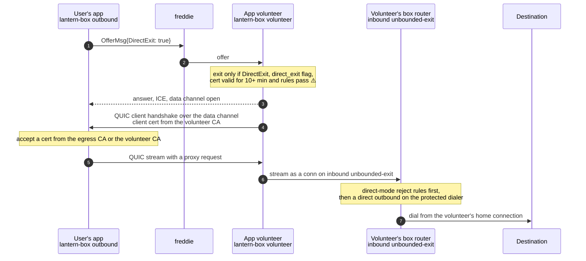

# Volunteer direct exit

## Goal

App volunteers exit Unbounded traffic themselves instead of relaying it to the Unbounded egress server. This covers Action Mode (pool) volunteers and personal-proxy helpers alike. Browser widgets can't dial arbitrary destinations, so they keep relaying to the egress server.

Direct mode and reverse direct mode already exit from the helper: radiance's `peer/` box dials each destination itself under the server's reject rules. After this change, the only traffic that still reaches the egress server is traffic relayed by browser widgets, and traffic for users' apps too old to accept a volunteer exit.

Why: the egress server costs money for every byte an app volunteer relays, and the extra hop makes the WebRTC path slower than it needs to be.

## Decisions

| Decision | Choice |
|---|---|
| Rules | The same reject rules (allowlist and abuse blocks) that direct mode gets from `/v1/peer/register`. Missing rules mean no exit |
| How users verify an exit | lantern-cloud issues each app volunteer a short-lived exit certificate under a new volunteer CA. Users' apps trust it beside the egress CA |
| Where the exit runs | In lantern-box's volunteer service, reusing the egress server's stream handling, with each stream routed by the volunteer's own box |
| Who chooses | The user's offer says it can accept a volunteer exit. The volunteer decides per slot |
| Web widgets | Unchanged. They relay to the egress server |
| Rollout | Behind a lantern-cloud `direct_exit` flag for volunteers. Turning it off makes volunteers relay again |

## How it works today

- The app volunteer is a sing-box service in lantern-box (`protocol/unbounded/volunteer.go`). It runs broflake's widget code (`bfOpt.ClientType = "widget"`). WebRTC slot *i* pipes packets to egress connection *i*, a WebSocket that `NewJITEgressConsumer` opens once a user connects.
- The user's app is the QUIC **server** on that path (`clientcore/quic.go`, `quic.Listen` over the `BroflakeConn`). The egress server dials in as the QUIC **client** and shows a client certificate. The user's app checks it against the pinned egress CA and server name (`lantern-box protocol/unbounded/tls.go`, `selfSignedTLSConfig`).
- The egress server (`egress/cmd/sing-box`) hands each QUIC stream to a sing-box inbound. That inbound serves the user's proxy requests, including UDP over TCP (`uot.go`).
- A user's app has a single WebRTC slot, so one volunteer at a time. When the path moves, a new QUIC connection replaces the old one (`acceptConns`).

## Design

### unbounded `clientcore`

- `OfferMsg` gets `DirectExit bool` with `json:",omitempty"`. New users' apps set it. An old user's app leaves it out, and an old volunteer ignores it.
- Volunteer slot *i* records the `DirectExit` of the offer it accepted. Worker *i* on the egress side reads that flag when the slot connects.
- `EgressOptions` gets `Exit *ExitOptions`, which is nil by default and always nil in a browser widget:
  - `TLSConfig func() (*tls.Config, bool)` returns the current exit certificate config, or false when there is no certificate valid for at least 10 more minutes.
  - `Handler func(net.Conn)` serves one stream.
  - `Allowed func() (bool, string)` reports whether the embedder's rules and flag allow exiting now, and if not, why.
- **The exit worker.** Instead of the JIT WebSocket, a slot runs a local exit when all of these hold:
  - the user's offer had `DirectExit`;
  - `Exit` isn't nil;
  - `Allowed` says yes;
  - `TLSConfig` returns a certificate.
  
  The local exit:
  - pipes the slot's packets into an in-memory `net.PacketConn`;
  - runs the egress server's QUIC client over it with the exit certificate;
  - passes each accepted stream to `Handler`.
  
  Otherwise the slot relays as today. The choice is made per slot when the slot connects and never changes for that session.
- **Shared stream handling.** The QUIC client loop and per-stream handling move out of `egress/` into a package both the egress server and the exit worker import, for example `common/exitcore`. The egress server keeps its widget-only accounting (activations, donor geography, freeze reports, stats). UDP over TCP (`egress/cmd/sing-box/uot.go`) moves to the shared package, so app volunteers serve it too.
- If a stream's destination fails, only that stream fails. Losing the exit's QUIC connection ends the slot's session, as losing the egress WebSocket does today.

### lantern-box

**Volunteer (`protocol/unbounded/volunteer.go`):**
- **Handler.** It supplies `Exit.Handler`, which passes each stream into the box's router as a connection on an inbound tagged `unbounded-exit`. Its metadata carries no address of the user.
- **Route rules.** lantern-cloud ships the rules for `unbounded-exit`: the direct-mode reject rules first, then a final rule to a direct outbound that dials through the protected dialer from lantern-box#449. So exit traffic leaves on the physical interface, never through the volunteer's own Lantern tunnel.
- **DNS.** Hostnames are resolved through the box's local DNS transport, as #449 does, not through the volunteer's tunnel.
- **Rule check.** `Allowed` checks those rules the way radiance's `validateAbuseRules` does, against the same rule sets and canaries (`10.0.0.0/8`, port 25). Missing rules, or an off `direct_exit` flag, mean no exit, and the volunteer relays.
- **Certificate.** The volunteer creates an ECDSA P-256 key on the device and keeps it only in memory. It gets a certificate from lantern-cloud at start, then renews it once half its lifetime has passed. After a failed renewal it retries with backoff. `TLSConfig` returns false once the certificate has fewer than 10 minutes left.

**Users' apps (`protocol/unbounded/outbound.go`, `tls.go`):**
- They set `DirectExit` on their offers.
- Options get `volunteer_exit_ca` and `volunteer_exit_server_name`. The QUIC server's `VerifyConnection` accepts a client certificate that chains to the egress CA with the egress server name, or to the volunteer CA with the volunteer server name.
- If either CA fails to parse, the outbound fails to start, as a bad egress CA does today. An empty `volunteer_exit_ca` keeps today's egress-only behaviour.

### lantern-cloud

- **Volunteer CA.** Its key is a secret in the same store as the egress CA's key. Its certificate goes to users' apps in `config-new` as `volunteer_exit_ca`, beside the fixed `volunteer_exit_server_name`.
- **`POST /v1/unbounded/exit-cert`.** It takes a PKCS#10 request and the device ID headers every API call carries, and returns a certificate signed by the volunteer CA. The certificate:
  - is valid for 24 hours;
  - has the fixed volunteer server name as its only SAN;
  - is for client authentication only.
- **Refusals.** It refuses when:
  - the device has no Unbounded volunteer route in `config-new` (it isn't volunteering);
  - the device is blocked;
  - the request's country is censored or unknown, by `regions.IsCensoredCountry`, as `helperWidgetAllowed` decides.
  
  Blocking a device stops renewal, so it stops exiting within 24 hours.
- It is rate limited per device, and logs neither the request's IP nor the certificate.
- **Volunteer config.** `config-new` gives volunteers the `unbounded-exit` route rules, built from the same source as `/v1/peer/register`'s reject rules, and the `direct_exit` flag.

### What doesn't change

- Browser widgets, the egress server's handling of them, and the leaderboard, which counts widgets only.
- Direct mode and reverse direct mode.
- Old users' apps. They never send `DirectExit`, so every volunteer relays for them.

## Privacy and abuse

- **The volunteer sees destinations.** Through DNS names and TLS SNI, an exiting volunteer sees which sites the user visits, for strangers in Action Mode as well as for paired friends. It still can't see HTTPS content. Today a WebRTC volunteer sees only the user's IP. This is the largest change for Action Mode users. The app's copy on both sides should say so, which belongs with the planned risk-acknowledgement modals and is not part of this change.
- **The volunteer's home IP carries strangers' traffic.** This is the same exposure the direct-mode pool already accepts. It is limited by the same reject rules, and the rule check means a volunteer never exits without them.
- **No exits in censored countries.** lantern-cloud never issues an exit certificate to a device in a censored or unknown country, so a volunteer in Iran can't be anyone's exit. Refusing direct-mode helpers in censored countries (`helperRouteCensoredFor`) is a separate lantern-cloud change.
- **A malicious volunteer** can register and get a certificate like anyone else. The certificate proves only that lantern-cloud registered it, and lets us stop it by refusing renewal.
- **Logs.** The volunteer logs no destinations and no user IPs. Refusals are counted by rule only, with no hosts.

## Telemetry

**Volunteer (otel, no addresses or hosts):**
- `unbounded.exit.streams{result}` and exit bytes up and down;
- `unbounded.exit.refused{rule}`;
- `unbounded.exit.mode{mode, reason}`:
  - `mode` is `exit` or `relay`;
  - `reason` is `old_consumer`, `flag_off`, `no_cert` or `rules_invalid`, set when relaying;
- `unbounded.exit.cert{result}` for renewals.

**User's app:** `unbounded.quic.peer{ca}`, where `ca` is `egress` or `volunteer`, counted per accepted QUIC connection, so we can see how much traffic avoids the egress server.

## Testing

**unbounded:**
- The shared stream handling keeps the egress server's existing tests passing.
- clientcore tests run a user's app, a volunteer and a local destination over the virtual network in every combination of:
  - old and new user's app;
  - exit allowed or refused for each reason;
  - widget or app volunteer.
- They check that the user's app rejects a client certificate from the wrong CA, an expired one, and one with the wrong server name.
- They check that a slot keeps its choice for its whole session.

**lantern-box:**
- An in-process test with freddie, a user's app and a volunteer exits to a local HTTP server, and checks:
  - a request to `10.0.0.0/8` or port 25 is refused;
  - missing rules make the volunteer relay;
  - an expiring certificate makes it relay.
- Outbound tests cover both CAs and their server names, and a bad `volunteer_exit_ca`.

**lantern-cloud:**
- Exit-certificate tests cover issuing it, and refusing it when the device isn't volunteering, is blocked, is in a censored or unknown country, or is rate limited.
- They check the certificate's lifetime, SAN and extended key usage.
- They check that `config-new` carries the CA, the rules and the flag.

## Rollout

1. lantern-cloud: the volunteer CA, the endpoint, and the `config-new` fields, with `direct_exit` off.
2. unbounded, then lantern-box, then radiance and lantern version bumps. New users' apps send `DirectExit`, which does nothing until volunteers have the flag.
3. Turn on `direct_exit` for internal volunteers, then by percentage. Watch:
   - the exit-versus-relay counts;
   - the refusal counts;
   - stream failure rates against relayed sessions;
   - egress server bytes.
4. To roll back, turn the flag off. Volunteers relay again, with no client release.

## Out of scope

- The app's warning copy and risk-acknowledgement modals.
- Refusing direct-mode helpers in censored countries.
- Any change to browser widgets or to the leaderboard.
