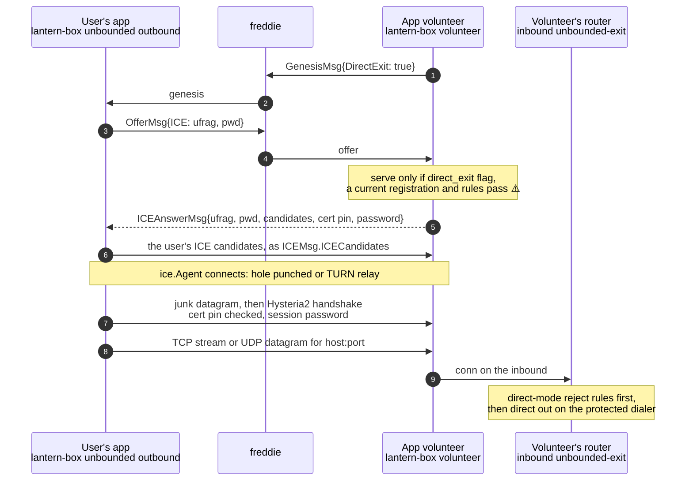

# Volunteer direct exit

## Goal

App volunteers exit Unbounded traffic themselves instead of relaying it to the Unbounded egress server. This covers Action Mode (pool) volunteers and personal-proxy helpers alike. Browser widgets can't dial arbitrary destinations, so they keep relaying to the egress server.

Every app on both sides already embeds lantern-box. So an app volunteer works like a Lamplighter node (`lantern-box serve --register`), not like the egress server: it gets the reject rules from lantern-cloud's peer API, and its own router dials each destination.

Between two apps, the WebRTC stack is replaced by:
- ICE alone, which punches the hole or allocates a TURN relay as today;
- Hysteria2 straight over that path, with no DTLS and no SCTP.

The user's lantern-box runs a `hysteria2x` outbound with its pre-Initial junk. The volunteer's lantern-box serves Hysteria2 on the same path.

The paths after this change:

| Path | Transport | Exit |
|---|---|---|
| 1. Direct peer: a port mapped by NAT-PMP, UPnP, PCP or by hand (direct mode), or reverse direct mode | samizdat, unchanged | The helper |
| 2. App to app, hole punched | ICE + Hysteria2X | The volunteer |
| 3. App to app, through TURN | ICE + TURN + Hysteria2X | The volunteer |
| Browser widget, or an old app on either side | WebRTC data channel + QUIC, unchanged | The egress server |

Why: the egress server costs money for every byte an app volunteer relays, and the extra hop makes the path slower. Dropping SCTP removes a second congestion controller and its head-of-line blocking. Dropping DTLS removes a second handshake and a second layer of encryption that QUIC already provides.

## Decisions

| Decision | Choice |
|---|---|
| Model | A Lamplighter node, not the egress server. The volunteer's own router exits |
| Transport | pion `ice.Agent` alone, then Hysteria2 on the `ice.Conn`. No DTLS, no SCTP |
| Client protocol | `hysteria2x` with `pre_initial_junk` on. Salamander obfuscation is off, with a config switch to turn it on per country |
| Congestion control | BBR. Brutal is never used: a fixed send rate is harmful on a volunteer's home uplink and on shared TURN relays |
| Rules | The same reject rules (allowlist and abuse blocks) that direct mode gets from `/v1/peer/register`, enforced by the volunteer's router |
| Volunteer config | Every app volunteer registers through the peer API in a WebRTC-only mode: no listener, no dial-back, no pool route. It registers again hourly, as nodes do |
| Credentials | The volunteer's answer, relayed by freddie over TLS, carries the SHA-256 pin of its certificate's public key and a Hysteria2 password minted for the session. Pool and personal-proxy sessions work the same way |
| Negotiation | The volunteer's genesis says it can do this. A new user's app answers such a genesis with an ICE offer, and any other genesis with today's SDP offer |
| Web widgets | Unchanged |
| Rollout | Behind a lantern-cloud `direct_exit` flag for volunteers. Turning it off makes volunteers advertise and serve only today's path |

## How it works today

**Unbounded:**
- The app volunteer is a sing-box service in lantern-box (`protocol/unbounded/volunteer.go`). It runs broflake's widget code. WebRTC slot *i* pipes packets to egress connection *i*, a WebSocket opened when a user connects.
- The user's app and the volunteer set up a PeerConnection through freddie: genesis, offer (`OfferMsg` with SDP), answer (a bare `SessionDescription`), then ICE candidates (`ICEMsg`).
- The data channel is unordered with no retransmits (`clientcore/consumer.go:161`). The user's app runs a QUIC server over it, and the egress server dials in as the QUIC client.
- Our ICE settings (STUN and TURN servers, `iceNet`, the protected net from lantern-box#449, tuning) go in through pion's `SettingEngine`. They're ICE-level settings, so they carry over to a bare `ice.Agent`.

**Lamplighter node** (`lantern-box node/`): it registers through `/v1/peer/register`, runs the returned sing-box config with the reject rules, and registers again every hour.

**Hysteria2 pieces:**
- sing-quic's `hysteria2.Service.Start(net.PacketConn)` serves any packet conn.
- lantern-box's `hysteria2x` outbound builds a sing-quic client around an `N.Dialer`. Its `junkDialer` writes one random 8–64 byte long-header datagram before the QUIC Initial, which quic-go drops without replying (`protocol/hysteria2x/outbound.go`).

## Design

### unbounded `clientcore`: ICE sessions

**Signaling.** Freddie's volunteer socket accepts only genesis and answer messages, and freddie times each step by message type. So the ICE session reuses today's types, with new optional fields, and freddie doesn't change:
- `GenesisMsg` gets `DirectExit bool` (`json:",omitempty"`). A volunteer sets it only when `Exit.Ready` (below) is true. Old users' apps ignore it.
- The ICE offer is an `OfferMsg` with `ICE *ICEOffer{Ufrag, Pwd}` and an empty SDP. It keeps `OfferMsg`'s `Tag`, `Country` and `Pairing`. A decoder reads an ICE offer without its SDP, because pion can't read back a zero `SessionDescription`'s "unknown" type.
- The ICE answer is a `SignalMsgAnswer` whose payload is `ICEAnswerMsg{ICE *ICEAnswer{Ufrag, Pwd, Candidates, CertPin, Password}}`. The volunteer's candidates travel in it, as today's answer SDP carries them.
- The user's candidates go in `ICEMsg.ICECandidates []string`, in pion's `ice.Candidate.Marshal` form.
- A new user's app answers a `DirectExit` genesis with an ICE offer, and any other genesis with today's SDP offer. An old volunteer never sets `DirectExit`, so it never receives an ICE offer.
- Rooms, tickets, pairings and freddie's routing don't change. Freddie's ICE-NAT metrics don't classify ICE sessions, since they carry no SDP.

**The ICE session:**
- Both sides create a pion `ice.Agent` from the same `WebRTCOptions` as today: STUN and TURN servers, candidate types, `iceNet`, the protected net, NAT-fail timeout and tuning.
  - The user's app is the controlling agent and dials.
  - The volunteer is the controlled agent and accepts.
  
  The result is an `ice.Conn`, a `net.Conn` over the chosen pair, punched or relayed. pion keeps STUN out of what `Read` returns.
- Both sides treat the conn as a `net.PacketConn` of one peer through a small adapter. Its addresses are fixed placeholders, the same for every session, so nothing that logs them logs a user IP.
- If the agent fails or disconnects, the session ends like a failed WebRTC session today, and the user's app moves to the next genesis.
- The consumer's single slot, its no-path guard and its connection-state reporting cover ICE sessions as well as PeerConnections.

**Embedder hooks.** These keep `clientcore` free of Hysteria2.
- Volunteer: `WebRTCOptions.Exit *ExitOptions`, nil by default and always nil in a browser widget.
  - `Ready func() bool` says whether to set `DirectExit` in a genesis.
  - `Params func() (pin, password string, ok bool)` mints a session's credentials.
  - `Serve func(ctx context.Context, conn net.PacketConn, password string)` serves one session.
- User: the consumer reports `ExitPath{Conn net.PacketConn, CertPin, Password string}` to its embedder, instead of feeding the QUIC layer.
  - `WebRTCOptions.TakeExit func() bool` lets lantern-box stop taking direct exits after repeated Hysteria2 failures, falling back to today's path.
- A volunteer slot serving an ICE session leaves its egress worker idle. A slot serving a PeerConnection relays to the egress server as today.

### lantern-box

**Volunteer (`protocol/unbounded/volunteer.go`):**
- **Registration.** It registers through the peer API in WebRTC-only mode, reusing `node/`'s API client and rotation. The returned config is merged into the volunteer's box, which is the app's VPN box. It carries the reject rules for inbound `unbounded-exit`, then a final rule to a direct outbound on the protected dialer from lantern-box#449. Exit traffic leaves on the physical interface, never through the volunteer's own Lantern tunnel. Hostnames resolve through the box's local DNS transport, as #449 does.
- **Certificate.** The volunteer creates a self-signed ECDSA P-256 certificate at start, kept only in memory. Its SHA-256 public-key pin goes in each answer.
- **Serving a session.** `Exit.Serve` starts a sing-quic `hysteria2.Service` on the session's packet conn with these settings:
  - that certificate;
  - one user, the session's password, which is 32 random bytes;
  - BBR, with Brutal never negotiated.
  
  Each TCP stream and UDP flow goes to the router with inbound `unbounded-exit`, as a custom inbound like `samizdatreverse.Bridge`. The service closes when the session ends.
- **Readiness.** `Exit.Ready` and `Exit.Params` are false if any of these hold:
  - the `direct_exit` flag is off;
  - the volunteer has no current registration;
  - the rules fail the same check as radiance's `validateAbuseRules` (`peer/validate.go`). That check moves to lantern-box so both can import it.

**Users' apps (`protocol/unbounded/outbound.go`):**
- For an `ExitPath`, the outbound builds a `hysteria2x` client:
  - its dialer returns the session's conn;
  - `pre_initial_junk` is on;
  - its TLS config accepts only a certificate matching `CertPin`;
  - it uses the session's password and a fixed, harmless SNI from config.
- Salamander obfuscation is off by default, with config switches for it and for the SNI. The volunteer's service takes the same switch from its registration.
- `DialContext` and `ListenPacket` use whichever path is current, Hysteria2 or QUIC, so callers see no difference.

### lantern-cloud

- **WebRTC-only registration.** `/v1/peer/register` gets `mode: "webrtc"`. lantern-cloud returns a config with:
  - the `unbounded-exit` route rules, built from the same source as today's registrations;
  - the obfuscation settings;
  - a rotation interval.
  
  It creates no `peer_routes` row, does no dial-back, and expects no heartbeats.
- **Refusals.** It refuses when:
  - the device isn't volunteering for Unbounded;
  - the device is blocked;
  - the request's country is censored or unknown, by `regions.IsCensoredCountry`, as `helperWidgetAllowed` decides.
  
  A refused or blocked device stops exiting when its current registration expires.
- **Config.**
  - `config-new` gives volunteers the `direct_exit` flag.
  - It gives users' apps the SNI and the Salamander switch, both settable per country.

### What doesn't change

- Browser widgets, the egress server, and the leaderboard, which counts widgets only.
- Direct mode and reverse direct mode.
- Old apps on either side. They never see or send the new messages, so they use today's path.

## On the wire

A censor on the user's side sees:
- STUN binding checks, as any WebRTC call starts with;
- one short datagram with the QUIC long-header bit set;
- QUIC.

On a TURN path it sees the same inside TURN ChannelData to the relay. TURN over UDP isn't encrypted, so the QUIC Initial is readable there too.
- **The SNI** in the Initial is the harmless name we configure, not the volunteer's.
- **The junk datagram** defeats Initial inspection that assumes the first non-STUN datagram is the Initial, as China's does.
- **No DTLS** means no DTLS handshake to fingerprint, which is what Russia used against Snowflake in 2021.
- **The cost:** "STUN, then QUIC" is a rare pattern. A censor that allows only known protocols, as some Iranian networks do during unrest, could block it outright.

If that happens, lantern-cloud can turn on Salamander per country, or turn off `direct_exit` there, with no client release.

## Privacy and abuse

- **The volunteer sees destinations.** An exiting volunteer sees each TCP stream's and UDP flow's host and port, for strangers in Action Mode as well as for paired friends. It still can't see HTTPS content. Today a WebRTC volunteer sees only the user's IP. This is the largest change for Action Mode users. The app's copy on both sides should say so, which belongs with the planned risk-acknowledgement modals and is not part of this change.
- **The volunteer's home IP carries strangers' traffic.** This is the same exposure the direct-mode pool already accepts. It is limited by the same reject rules, and the readiness check means a volunteer never exits without them.
- **No exits in censored countries.** lantern-cloud never registers a WebRTC-only exit for a device in a censored or unknown country. Refusing direct-mode helpers in censored countries (`helperRouteCensoredFor`) is a separate lantern-cloud change.
- **Trust in the pin.** The user pins what came in the answer through freddie, over TLS. A malicious volunteer can register like anyone else. The pin proves only that the user reached the volunteer that answered, which is all a pool session can promise. Refusing a device's registration stops it exiting.
- **Session credentials.** The password and pin are per session and per process, so a leaked one gives nothing beyond that session.
- **Logs.** The volunteer logs no destinations and no user IPs. Refusals are counted by rule only, with no hosts.

## Risks

- **Driving ICE ourselves.** PeerConnection gave us ICE restarts, consent freshness and state handling. We now own:
  - candidate exchange;
  - the agent's lifecycle;
  - consent checks, which pion's agent does;
  - teardown.
  
  QUIC's own keepalives keep the NAT binding open.
- **Two stacks in the user's app.** ICE plus Hysteria2 for app volunteers, and the PeerConnection plus QUIC path for widgets and old volunteers, until old volunteers age out.
- **More registrations.** Every app volunteer now registers hourly. lantern-cloud's peer-register rate limits and load need checking for the pool's size.

## Telemetry

**Volunteer (otel, no addresses or hosts):**
- `unbounded.exit.sessions{path, reason}`:
  - `path` is `ice` or `webrtc`;
  - `reason` is `old_consumer`, `flag_off`, `no_registration` or `rules_invalid`, set for `webrtc`;
- exit bytes up and down;
- `unbounded.exit.refused{rule}`;
- registration results.

**User's app:** `unbounded.path{kind, relayed}` per session, where:
- `kind` is `ice` or `webrtc`;
- `relayed` says whether ICE chose a TURN pair.

So we can see how much traffic avoids the egress server, and how much goes through TURN.

## Testing

**unbounded:**
- clientcore tests over pion's virtual network cover every combination of:
  - old and new user's app;
  - old and new volunteer;
  - flag on or off;
  - widget or app volunteer;
  - punched and TURN-relayed pairs.
- They check:
  - a new user's app sends an ICE offer only to a `DirectExit` genesis;
  - an ICE session carries datagrams intact both ways;
  - an agent failure ends the session and the user's app moves on.

**lantern-box:**
- An in-process test with freddie, a user's app and a volunteer exits to a local HTTP server and a local UDP echo server, and checks:
  - a request to `10.0.0.0/8` or port 25 is refused;
  - a wrong pin or password fails the handshake;
  - another session's password is rejected;
  - BBR is in use;
  - the junk datagram goes first and gets no reply;
  - missing rules or no registration make the volunteer advertise only the old path.
- A benchmark compares the ICE plus Hysteria2 path with today's relayed path, on lossy virtual links (0, 2 and 5% loss, 50–200 ms RTT) and through a real TURN relay. It measures bulk throughput, stream-open latency and throughput while another stream is losing packets.

**lantern-cloud:**
- Tests cover WebRTC-only registration: a config with no listener, no route row and no dial-back.
- They cover refusals when the device isn't volunteering, is blocked, or is in a censored or unknown country.
- They check that the reject rules match a normal registration's.

## Rollout

1. lantern-cloud: WebRTC-only registration, the `direct_exit` flag (off), and the SNI and Salamander settings.
2. unbounded, then lantern-box, then radiance and lantern version bumps. New users' apps understand `DirectExit`, which does nothing until volunteers have the flag.
3. Run the benchmark. Turn on `direct_exit` for internal volunteers and compare the ICE path's throughput and failures with relayed sessions. Then go out by percentage, watching:
   - the ICE-versus-WebRTC counts;
   - the TURN share;
   - the refusal counts;
   - egress server bytes.
4. To roll back, turn the flag off, globally or per country. Volunteers go back to today's path, with no client release.

## Out of scope

- The app's warning copy and risk-acknowledgement modals.
- Refusing direct-mode helpers in censored countries.
- Any change to browser widgets, the egress server or the leaderboard.
- Other protocols on path 1. Port-mapped direct mode stays samizdat for now. Later it should accept any inbound protocol lantern-box supports.
